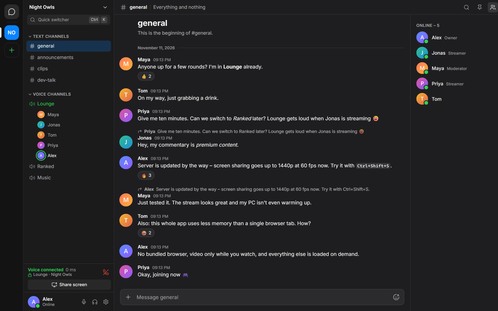
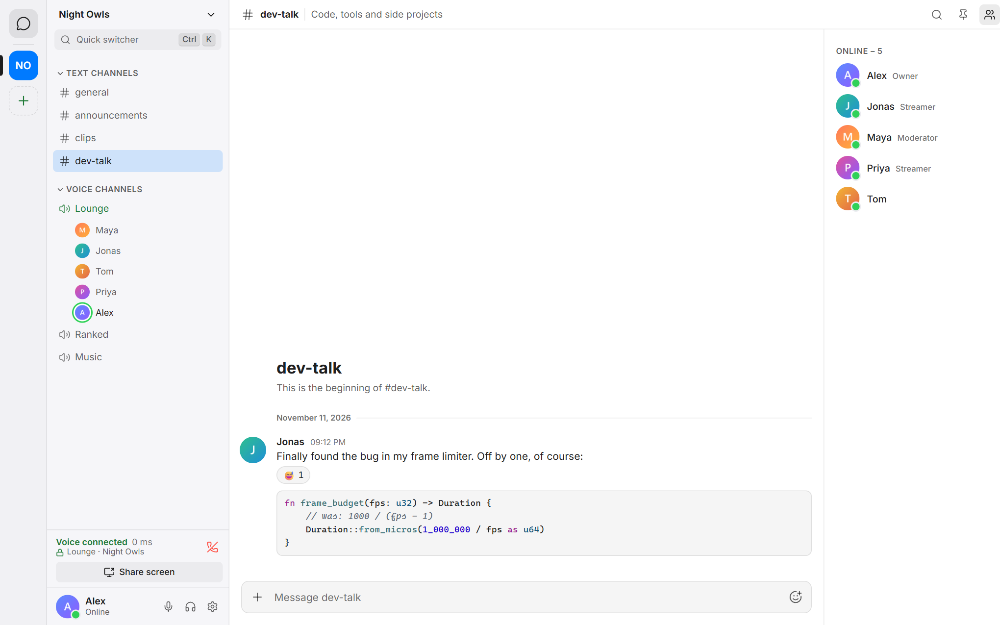
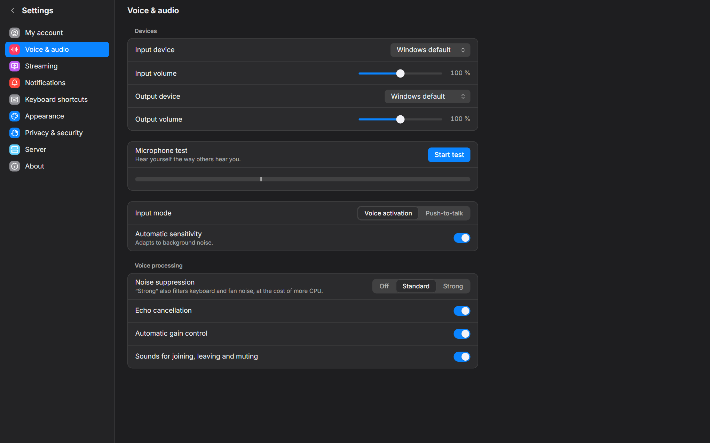

<div align="center">


# Lightspeak

**Self-hosted voice chat, text chat and screen sharing for you and your friends –<br>with a Windows app that uses about a tenth of the memory.**

[](https://github.com/syntstar/lightspeak/actions/workflows/ci.yml)
[](https://github.com/syntstar/lightspeak/releases/latest)
[](LICENSE)

[Download](https://github.com/syntstar/lightspeak/releases/latest) ·
[Quick start](#quick-start) ·
[Host your own server](docs/SELF_HOSTING.md) ·
[User guide](docs/USER_GUIDE.md)

</div>

---



Lightspeak is a small, private alternative to Discord and TeamSpeak. You run the server yourself – on a cheap VPS, a Raspberry Pi or an old PC – and invite your friends with a link. There is no central service, no account with a company, no tracking and no ads.

It was built around one idea: **a chat app should not need a gigabyte of RAM.** The Windows app is a few megabytes, starts in under a second and stays out of the way while you play.

## Highlights

- 🎙️ **Voice channels that just work** – Opus audio, noise suppression, echo cancellation, per-user volume, and global push-to-talk (keyboard or mouse buttons) that also works in full-screen games.
- 🖥️ **Screen sharing up to 1440p / 60 fps** – hardware-encoded H.264, with the sound of *just the shared app* or the whole system (without your friends' voices echoing back).
- 🔒 **End-to-end encrypted calls** – voice, screen and stream audio are encrypted on your devices. The server only forwards data it cannot decrypt.
- 💬 **Text chat** – spaces, channels and categories, direct messages and group chats, replies, reactions, pins, mentions, Markdown with syntax highlighting, full-text search and files up to 200 MB.
- 🛡️ **Roles and permissions** – per-space roles, per-channel overrides, private channels, announcement channels, stage-style voice channels, an away channel and slow mode.
- 🪶 **Lightweight** – see the numbers below. What you don't use costs nothing: video is only received while you watch, and the app trims its memory when it sits in the tray.
- 🌍 **No install needed for guests** – the same client runs in Chrome, Edge, Firefox and Safari (also on macOS and Linux), served by your own server.
- 🧰 **One-command server** – a single installer sets up the server, [LiveKit](https://livekit.io) and HTTPS certificates as systemd services. No Docker, about 250 MB of RAM in total.
- 🇬🇧 🇩🇪 **English and German**, light and dark theme, accent colours.

| Light theme | Voice settings |
| :---: | :---: |
|  |  |

## How light is it?

Measured on Windows 11 with the release build (whole process tree, including WebView2):

| | Lightspeak | Discord (for comparison) |
|---|---|---|
| Window open, idle | 80–150 MB | ~1,080 MB |
| Minimised to the tray | ~70 MB | – |
| In a voice channel | ~150 MB | – |
| Idle CPU | ~0.1 % | ~0.6 % |
| Installer | ~2 MB | – |
| Cold start until usable | ~0.4 s | – |

The server side (Lightspeak server + LiveKit + Caddy) idles at roughly 250 MB of RAM on a small VPS.

<details>
<summary>How is that possible?</summary>

- The app is built with [Tauri](https://tauri.app): it uses the WebView2 runtime that Windows already ships instead of bundling its own browser.
- The interface is plain [Svelte](https://svelte.dev) with hand-written CSS – no UI framework, about 125 KB of JavaScript (gzip) at start. Everything else is loaded on demand.
- Message lists are virtualised, images are loaded as server-side thumbnails, and video tracks are only subscribed while a stream is actually on screen.
- Native parts (push-to-talk hook, per-app audio capture, encryption keys) are written in Rust and only run while they are needed.

</details>

## Quick start

### I just want to join my friends' server

1. Open the **invite link** you received.
2. Click **Download Lightspeak for Windows** and run `Lightspeak-setup.exe` (no admin rights needed) – or pick **Open in browser** to skip the install.
3. Choose a username and a password. Done.

> Windows may show *"Windows protected your PC"* because the installer is not commercially code-signed. Click **More info → Run anyway**. You can verify the download against `SHA256SUMS` on the [releases page](https://github.com/syntstar/lightspeak/releases/latest).

More in the [user guide](docs/USER_GUIDE.md).

### I want to host a server

You need a Linux machine (Debian 12+ or Ubuntu 22.04+, x86_64 or arm64, 1 vCPU / 1 GB RAM is enough) with a public IPv4 address and two host names pointing at it – your own domain or free [sslip.io](https://sslip.io) names.

```bash
curl -fsSLO https://github.com/syntstar/lightspeak/releases/latest/download/install.sh
sudo bash install.sh --version latest
```

The installer asks a few questions, shows what it is going to do and only then changes anything. At the end it prints an **owner invite link**: open it, create your account, and you are the admin of your new server. Invite your friends from the app.

| Where | Good for | Notes |
|---|---|---|
| **VPS** (recommended) | Always on, fast upload | Any small plan works, from about €4 per month |
| **Home server** (Raspberry Pi, NAS, old PC) | No monthly cost | Needs a public IPv4 address and port forwarding |
| **Local** | Trying it out, development | One PC only, no HTTPS |

The full walkthrough – ports, firewalls, settings, backups and updates – is in **[docs/SELF_HOSTING.md](docs/SELF_HOSTING.md)**.

Updating later is one command, with a database backup and an automatic rollback if anything fails:

```bash
sudo lightspeak-admin update
```

The Windows app updates itself from the [GitHub releases](https://github.com/syntstar/lightspeak/releases) of this repository. Every update is signed, and the app only installs builds that carry a valid signature.

## Documentation

| | |
|---|---|
| [User guide](docs/USER_GUIDE.md) | Installing, talking, push-to-talk, sharing your screen |
| [Self-hosting](docs/SELF_HOSTING.md) | Setting up a server on a VPS, at home or locally; settings, backups, updates |
| [Admin guide](docs/ADMIN_GUIDE.md) | Roles, invites, moderation, accounts, storage, troubleshooting |
| [Security](docs/SECURITY.md) | Threat model, encryption, what the server can and cannot see |
| [Architecture](docs/ARCHITECTURE.md) | How the pieces fit together |
| [Contributing](CONTRIBUTING.md) | Building from source, tests, conventions |

## Security and privacy

- **Calls and screen shares are end-to-end encrypted.** Keys are created on your devices and never reach the server unencrypted. If encryption cannot be established, the call does not start – there is no unencrypted fallback.
- **Text messages and files are *not* end-to-end encrypted.** They travel over TLS and are stored on your server, so whoever runs the server can read them – the same trust model as Discord, except that the server is yours.
- Passwords are hashed with Argon2id. The Windows app keeps its session and keys in the Windows Credential Manager.
- Server and app releases are signed; the installer and the updater reject anything without a valid signature.

Details and the full threat model: [docs/SECURITY.md](docs/SECURITY.md). Found a vulnerability? Please report it privately – see the [security policy](.github/SECURITY.md).

## What Lightspeak deliberately does not do

- **Webcam video** – the focus is on voice and screen sharing.
- **Native macOS, Linux or mobile apps** – the desktop app is Windows-only; everything else uses the browser client.
- **A Docker image** – the installer sets everything up natively, which keeps memory use low.
- **End-to-end encryption for text and files** – only calls and screen shares are end-to-end encrypted.
- **Password reset by e-mail** – Lightspeak never asks for an e-mail address. A server admin sets a temporary password instead.
- **Federation or public server discovery** – a server is for a group of people who know each other.

## Building from source

```bash
# Server (Go)
cd server
go run ./cmd/lightspeak-server serve --dev

# Windows app (Node.js + Rust)
cd client
npm install
npm run tauri dev
```

Prerequisites, tests and the release process are described in [CONTRIBUTING.md](CONTRIBUTING.md).

## Built with

[Tauri](https://tauri.app) · [Svelte](https://svelte.dev) · [LiveKit](https://livekit.io) · [Go](https://go.dev) · [SQLite](https://sqlite.org) · [Caddy](https://caddyserver.com) – the complete list with licences is in [docs/THIRD_PARTY.md](docs/THIRD_PARTY.md).

## License

Lightspeak is free software, released under the [GNU Affero General Public License v3.0](LICENSE).

In short: you may use, study, change and share it. If you run a modified server for other people, you have to make your changes available to them under the same licence.
